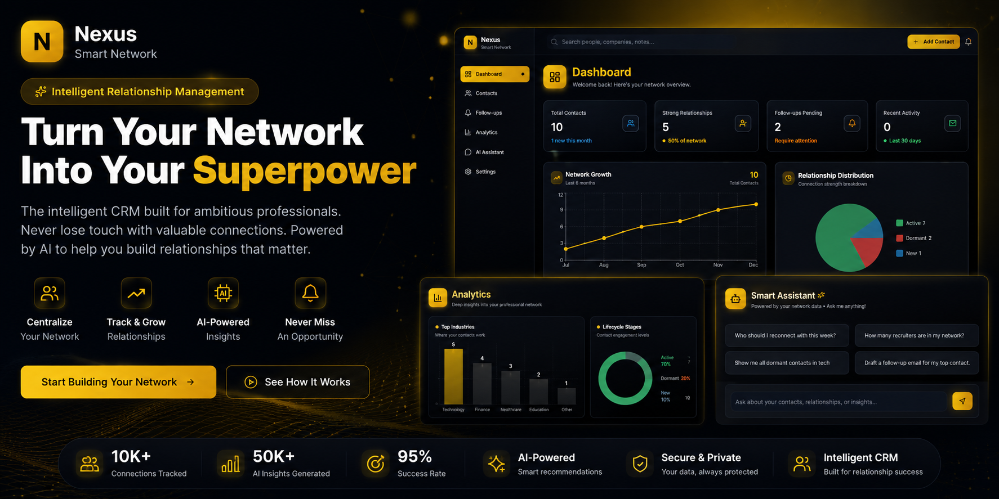

<div align="center">



# Nexus

### Secure relationship CRM built with Next.js, Convex, and Clerk

[](https://github.com/Mounusha25/Nexus_contact_Manager/actions/workflows/ci.yml)

</div>

Nexus helps an individual manage professional contacts, interaction history,
follow-ups, duplicate records, and relationship health. The application uses
Clerk for identity, Convex for the database and server functions, and Next.js
for the user interface.

## What is implemented

- Authenticated contact CRUD with ownership checks in Convex mutations.
- Per-user contacts, interactions, notes, follow-ups, analytics, duplicate
  candidates, and audit events across **7 indexed tables**.
- A deterministic **0-100 relationship score** based on channel quality,
  30/60/90-day recency decay, interaction frequency, and bidirectional contact.
- Lifecycle classification into `new`, `active`, `dormant`, and `archived`.
- Duplicate detection using normalized email and phone matching, Levenshtein
  name similarity, and company agreement.
- Transactional contact merging that preserves the two contacts' emails,
  phone numbers, tags, interactions, notes, and follow-ups.
- Account-scoped dashboard analytics and a deterministic local networking
  assistant that does not send contact data to a third-party model.
- Authenticated demo-data seeding for local evaluation.
- An account-scoped, append-only audit trail for security-relevant mutations.

## Security model

Every public Convex read or write resolves the active Clerk identity on the
server. The browser never supplies a trusted `userId`. Contact, follow-up,
analytics, tagging, merge, assistant, seed, and clear-data operations verify
that the requested records belong to that identity.

Milestone 1 removed unauthenticated debugging functions that previously
accepted arbitrary user IDs, added the missing ownership check to auto-tagging,
and prevented cross-account follow-up reads. It also upgraded:

- Next.js from `16.1.1` to patched `16.4.2`;
- Clerk from `6.36.5` to `7.9.17` and migrated to Clerk Core 3's `Show` API;
- route protection from the deprecated `middleware.ts` convention to
  `proxy.ts`.

`npm run security:audit` fails CI if a critical production dependency advisory
is detected. This is a dependency gate, not a claim that the application has
completed an external security audit.

Milestone 2 centralizes mutation authorization, returns non-enumerating errors
for cross-account resources, and records audit events in the same transaction
as each successful change. Audit history remains after a contact is deleted;
there is intentionally no public mutation for editing or deleting audit events.

## Relationship scoring

Each interaction starts with a channel weight:

| Channel | Weight |
| --- | ---: |
| Meeting | 10 |
| Call | 7 |
| Email | 4 |
| Direct message | 3 |
| Other | 2 |

The weight is multiplied by `1.0`, `0.65`, or `0.35` for interactions aged
0-30, 31-60, or 61-90 days. Frequency adds up to a `1.5x` multiplier and
two-way communication adds `1.2x`; the final result is capped at 100.

The implementation is isolated in
`lib/crm/contact-intelligence.ts`, making the business rules testable without a
database or browser.

## Verification

The repository currently passes:

| Check | Result |
| --- | --- |
| Native Node test runner | **18/18 tests passing** |
| Convex authorization integration suite | **5/5 tests passing** |
| Total automated tests | **23/23 tests passing** |
| CRM logic line coverage | **96.73%** |
| CRM logic branch coverage | **92.75%** |
| CRM logic function coverage | **100%** |
| TypeScript | `tsc --noEmit` passes |
| ESLint | passes with zero errors and zero warnings |
| Next.js production build | passes on Next.js `16.4.2` |
| Production critical-advisory gate | passes |

Run the same checks locally:

```bash
# 1. Clone the repository
git clone https://github.com/Mounusha25/Nexus_contact_Manager.git
cd Nexus_contact_Manager

# 2. Install and verify
npm ci
npm test
npm run test:coverage
npm run lint
npx tsc --noEmit
npm run build
npm run security:audit
```

## Architecture

```text
Browser
  |
  | Clerk session
  v
Next.js 16 App Router
  |
  | typed Convex queries, mutations, and actions
  v
Convex server functions
  |-- resolve authenticated Clerk identity
  |-- enforce record ownership
  |-- append account-scoped audit events in the mutation transaction
  |-- run CRM scoring and lifecycle rules
  `-- read/write indexed Convex tables
```

## Local setup

Requirements:

- Node.js 24+
- a Clerk application
- a Convex project configured with Clerk authentication

```bash
git clone https://github.com/Mounusha25/Nexus_contact_Manager.git
cd Nexus_contact_Manager
npm ci
cp .env.example .env.local
npx convex dev
npm run dev
```

Configure the values in `.env.local`:

```env
NEXT_PUBLIC_CLERK_PUBLISHABLE_KEY=
CLERK_SECRET_KEY=
NEXT_PUBLIC_CONVEX_URL=
NEXT_PUBLIC_CONVEX_SITE_URL=
CLERK_JWT_ISSUER_DOMAIN=
```

Open `http://localhost:3000`, sign in, and use `/seed-data` if you want an
account-scoped demo dataset.

## Repository structure

```text
app/                         Next.js routes
components/                  UI and Convex provider
convex/                      schema, server functions, and integration tests
convex/_generated/           reproducible typed Convex bindings
convex/lib/                  authorization and append-only audit helpers
lib/crm/                     deterministic CRM business rules
tests/                       native Node unit tests
.github/workflows/ci.yml     test, lint, build, and security gate
```

## Honest scope

Nexus is a portfolio application, not a deployed enterprise CRM. It does not
currently claim organization-level multi-tenancy, billing, email-provider
integration, third-party penetration testing, or production user volume.
